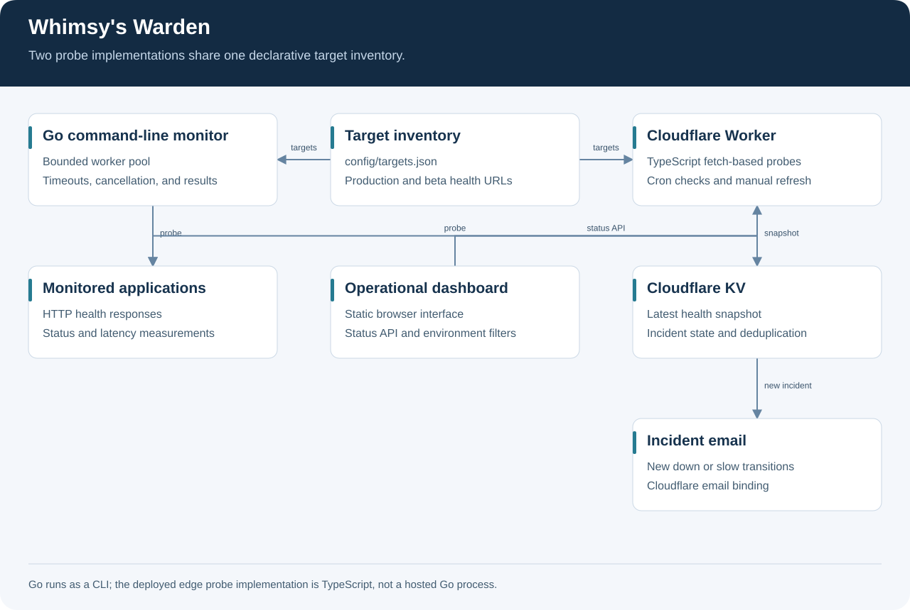

# Architecture

Two probe implementations share one declarative target inventory.

Go runs as a CLI; the deployed edge probe implementation is TypeScript, not a hosted Go process.

## Implementation references

- [cmd/healthmon](../cmd/healthmon)
- [internal/monitor/monitor.go](../internal/monitor/monitor.go)
- [config/targets.json](../config/targets.json)
- [worker/src/index.ts](../worker/src/index.ts)
- [web](../web)
- [wrangler.jsonc](../wrangler.jsonc)

## Project overview

[Portfolio project page](https://johnbieniek.com/projects/whimsy-warden)
